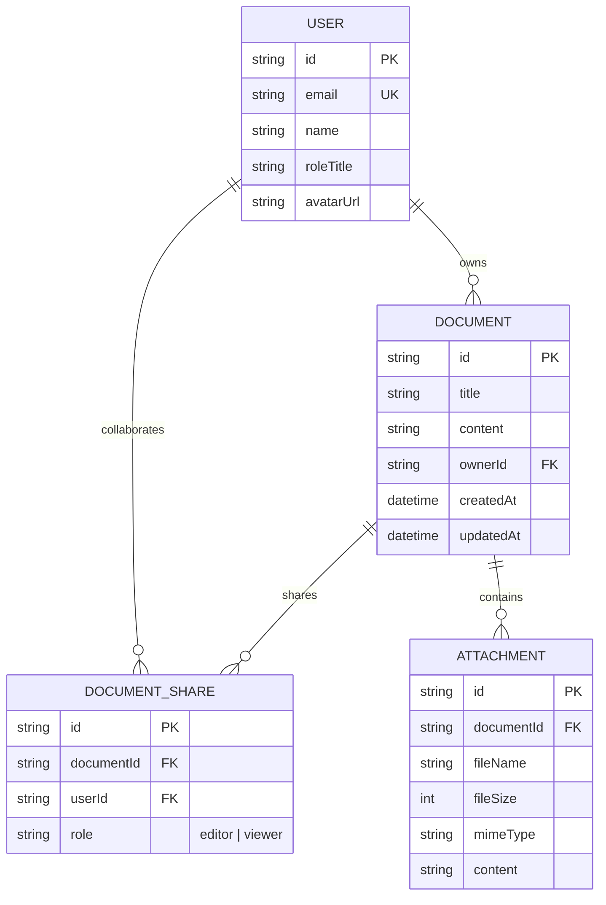

# Architecture & Product Engineering Note

## 1. Executive Summary & Goals
This project implements a lightweight collaborative document editor inspired by Google Docs, built under a strict 4–6 hour delivery constraint for Ajaia. 

Rather than chasing an overly broad, brittle clone, the goal was to ship **the highest-polish, fully working vertical slice** across document authoring, file handling, role-based sharing, and data persistence.

---

## 2. Key Prioritization Decisions & Tradeoffs

### Decision 1: Tiptap (ProseMirror) vs. Raw `contentEditable`
- **Choice**: Tiptap 3 with ProseMirror core.
- **Why**: Raw browser `contentEditable` is notoriously inconsistent across Chrome, Safari, and Firefox. It frequently produces malformed DOM structures, messy clipboard pastes, and erratic cursor jumps. Tiptap provides an explicit document model, standardized schema enforcement, and clean HTML/JSON serialization.
- **Tradeoff**: Required a 15-minute integration learning curve, but eliminated hours of cross-browser formatting bugs.

### Decision 2: Seeded Multi-Persona Switcher vs. Production OAuth
- **Choice**: Mocked multi-user switcher with 4 seeded team personas (Alex, Sarah, Marcus, Maya).
- **Why**: Setting up Google or GitHub OAuth requires reviewers to configure client secrets, redirect URIs, and verify email addresses. A top-bar switcher allows a reviewer to test complex permissions (e.g., *Alex edits -> switches to Marcus -> sees View-Only mode*) in 2 seconds.
- **Tradeoff**: Not suitable for an unauthenticated public SaaS launch, but provides 100% genuine backend role validation while respecting the reviewer's evaluation time.

### Decision 3: Prisma + SQLite with Dual-Deployment Readiness
- **Choice**: Prisma with SQLite (`file:./dev.db`).
- **Why**: Reviewers evaluating code locally should never fail because Docker isn't running or an external database connection string expired. SQLite runs out of the box with `npm run dev`. The relational schema cleanly maps to PostgreSQL / Neon with a one-line provider change for production cloud deployment.

### Decision 4: Multi-Format File Import (`.md`, `.txt`, `.docx`)
- **Choice**: Direct file parsing on upload to instantiate a live document.
- **Why**: In real team environments, users frequently paste notes or bring over legacy documentation. Parsing Markdown headings, bold/italic tokens, lists, and Word doc paragraphs directly into the Tiptap schema delivers immediate product utility.

---

## 3. What Was Intentionally Deprioritized

1. **Real-time CRDT / WebSockets (Yjs)**:
   - *Reasoning*: Implementing conflict-free replicated data types and multi-cursor WebSocket sync within 4–6 hours inevitably leads to race conditions, dropped socket frames, or editor desyncs. Instead, we prioritized rock-solid persistence, debounced background auto-save, and rigorous role-based access control.
2. **Infinite Nested Folder Trees**:
   - *Reasoning*: Flat, high-visibility dashboards separated by "My Documents" and "Shared with Me" reflect 90% of team document discovery needs.
3. **Complex Comment Threads / In-line Annotations**:
   - *Reasoning*: Better to have an exceptional authoring and sharing experience than a half-finished commenting sidebar.

---

## 4. Data Model & Access Control Architecture

### Relational Schema (Prisma)

### Authorization Matrix

| Action | Owner | Editor | Viewer | Non-Collaborator |
| :--- | :---: | :---: | :---: | :---: |
| **View Document** | ✅ Yes | ✅ Yes | ✅ Yes | ❌ 403 Forbidden |
| **Edit Content** | ✅ Yes | ✅ Yes | ❌ 403 Forbidden | ❌ 403 Forbidden |
| **Rename Title** | ✅ Yes | ✅ Yes | ❌ 403 Forbidden | ❌ 403 Forbidden |
| **Invite / Modify Collaborators** | ✅ Yes | ❌ 403 Forbidden | ❌ 403 Forbidden | ❌ 403 Forbidden |
| **Delete Document** | ✅ Yes | ❌ 403 Forbidden | ❌ 403 Forbidden | ❌ 403 Forbidden |

All capability checks are enforced **twice**:
1. **Client-side UX**: Viewers see a prominent "Viewing only" banner, toolbar buttons are disabled, and Tiptap is set to `editable: false`.
2. **Server-side API**: All mutating endpoints (`PATCH`, `DELETE`, `POST /share`) verify permissions using `lib/permissions.ts` and return strict HTTP 403 status codes upon unauthorized requests.

---

## 5. Reliability & Performance Considerations

- **Debounced Auto-save**: Auto-save triggers after 1000ms of typing inactivity. This minimizes database write contention and prevents UI input stutter.
- **Optimistic Title Synchronization**: Title updates react immediately in the local header, syncing to the database asynchronously.
- **Zero-Dependency Native Test Runner**: Automated unit tests execute directly via Node 22's native test runner (`node:test` + `tsx`), running in under 250ms without external framework overhead.
